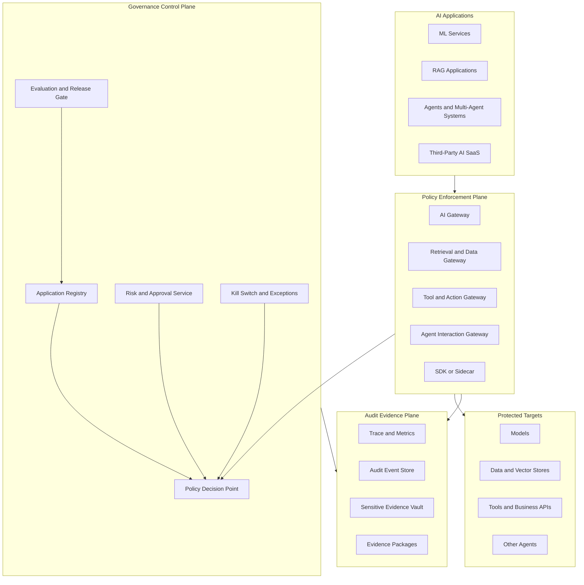
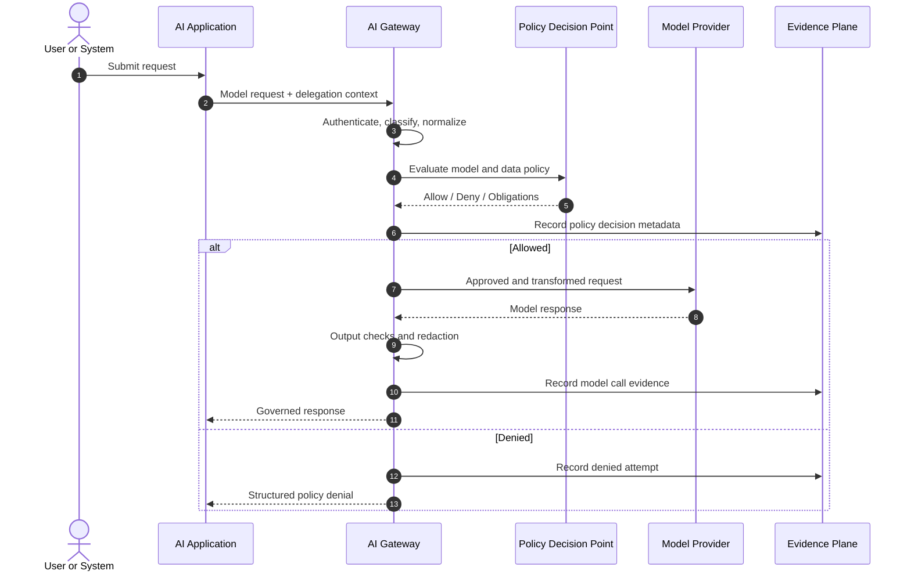
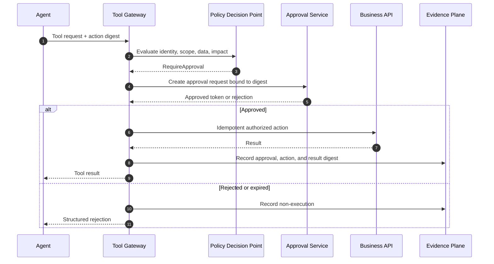
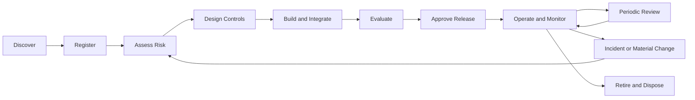
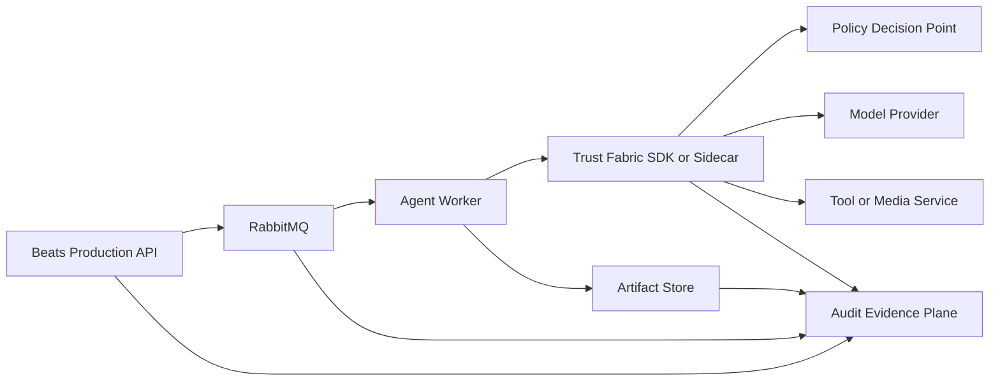

# AI Trust Fabric Architecture Specification

Language: [English](README.md) | [繁體中文](README.zh-TW.md)

> Status: Draft v0.1
>
> Last updated: 2026-10-28
>
> Intended audience: AI platform engineers, application teams, security teams, risk owners, auditors, SRE, and compliance teams

AI Trust Fabric is a technology-neutral governance runtime for AI applications. It provides common identity, policy, data, tool, approval, evaluation, and audit contracts without requiring every application to use the same AI framework.

Applications may be implemented with Microsoft Agent Framework, Semantic Kernel, LangGraph, OpenAI Agents SDK, custom services, conventional machine learning, RAG, third-party AI SaaS, or no agent framework at all. Compatibility is achieved through common control contracts and enforcement points rather than a shared application runtime.

This document defines the target architecture, mandatory contracts, trust boundaries, control model, runtime flows, and phased delivery plan.

## Table of Contents

- [1. Purpose](#1-purpose)
- [2. Goals and Non-Goals](#2-goals-and-non-goals)
- [3. Design Principles](#3-design-principles)
- [4. System Context](#4-system-context)
- [5. Trust and Identity Model](#5-trust-and-identity-model)
- [6. Architecture Components](#6-architecture-components)
- [7. Integration Levels](#7-integration-levels)
- [8. Core Contracts](#8-core-contracts)
- [9. Policy Model](#9-policy-model)
- [10. Runtime Flows](#10-runtime-flows)
- [11. Risk Classification](#11-risk-classification)
- [12. Data Governance and Privacy](#12-data-governance-and-privacy)
- [13. Security Requirements](#13-security-requirements)
- [14. Audit and Evidence](#14-audit-and-evidence)
- [15. Observability and Operations](#15-observability-and-operations)
- [16. Reliability and Failure Semantics](#16-reliability-and-failure-semantics)
- [17. Governance Lifecycle](#17-governance-lifecycle)
- [18. Control Mapping](#18-control-mapping)
- [19. Reference Deployment](#19-reference-deployment)
- [20. Beats Reference Integration](#20-beats-reference-integration)
- [21. MVP Roadmap](#21-mvp-roadmap)
- [22. Repository Layout](#22-repository-layout)
- [23. Open Decisions](#23-open-decisions)
- [24. Glossary](#24-glossary)
- [25. References](#25-references)

## 1. Purpose

The Trust Fabric must allow an organization to answer the following question for every material AI execution:

> Who, acting through which application or agent, under what delegated authority and policy version, sent which classified data to which model or tool, received what result, obtained which approval, and caused what downstream effect?

The platform controls five concerns:

1. Identity: who or what is making the request.
2. Scope: which model, data source, tool, and destination may be used.
3. Delegation: on whose behalf an agent or workload is acting.
4. Decision: which policy version allowed, denied, constrained, or paused the operation.
5. Evidence: how the decision and resulting action can be reconstructed later.

The Trust Fabric is not a single container around every AI system. It is a set of interoperable control-plane services, enforcement points, runtime contracts, and evidence pipelines.

## 2. Goals and Non-Goals

### 2.1 Goals

- Support conventional ML, generative AI, RAG, agents, multi-agent systems, MCP tools, APIs, and third-party AI SaaS.
- Apply consistent controls across local, cloud, SaaS, and hybrid environments.
- Preserve the end-user identity and delegated authority across model, retrieval, tool, and agent calls.
- Enforce least privilege and explicit allowlists for models, data, tools, destinations, and peer agents.
- Provide policy-as-code decisions that are versioned, testable, reviewable, and explainable.
- Produce structured, privacy-aware, tamper-evident audit evidence.
- Scale control depth according to use-case risk.
- Allow existing systems to adopt controls incrementally.
- Keep AI frameworks replaceable behind stable governance contracts.
- Support emergency suspension, bounded fallback, and recovery.

### 2.2 Non-Goals

- The Trust Fabric is not an AI model provider.
- It is not a universal agent implementation framework.
- It does not guarantee that model output is factually correct.
- It does not replace application-level authorization or business validation.
- It does not make an application compliant merely because the application is connected.
- It does not require all prompts and responses to be centrally stored.
- It does not treat MCP, A2A, an API gateway, or model content filters as a complete governance solution by themselves.
- It does not replace legal, privacy, security, model-risk, or business-owner judgment.

## 3. Design Principles

### 3.1 Common contracts, independent implementations

Applications share manifests, identities, policy decisions, audit events, and evidence formats. They remain free to choose their language, model provider, framework, deployment environment, and internal architecture.

### 3.2 Use-case governance

Registration and risk acceptance apply to a concrete AI use case, not merely to a model name. The same model may be low risk for public-text summarization and high risk when it can modify customer or financial records.

### 3.3 Zero trust for agents

An agent is a non-human workload identity. Its request must be authenticated, authorized, bounded, and continuously observable. An agent does not inherit unlimited authority from its developer, service account, or end user.

### 3.4 Preserve delegation

Every downstream request must preserve both:

- the human or system principal that initiated the work; and
- the workload identity that is currently acting.

The effective permission is the intersection of user authority, application authorization, agent capability, policy, and target-system authorization.

### 3.5 Enforce near the effect

Policies must be enforced where an effect can occur. A model gateway cannot fully protect retrieval systems, tool calls, peer-agent messages, file writes, payments, or database changes.

### 3.6 Evidence by design

Each material operation emits evidence at execution time. Audit reconstruction must not depend solely on application debug logs or operator memory.

### 3.7 Minimize sensitive telemetry

Metadata, identifiers, hashes, classifications, policy decisions, and references are preferred over raw prompts, responses, documents, credentials, or tool arguments. Sensitive content collection is opt-in, purpose-bound, encrypted, access-controlled, and retained for a defined period.

### 3.8 Risk-proportional controls

Low-risk use cases should not be forced through the same operational process as autonomous systems that can affect customers, money, safety, or regulated records.

### 3.9 Fail safely

High-impact actions fail closed when identity, policy, approval, or evidence services are unavailable. Low-risk read-only operations may use explicitly approved bounded fallback policies.

### 3.10 Human accountability remains

Automation may assist decisions and execute bounded actions, but ownership, approval, exception acceptance, and incident response remain assigned to accountable people and organizational roles.

## 4. System Context



### 4.1 Plane separation

| Plane | Responsibility | Must not become |
|---|---|---|
| Application plane | Business logic and AI capability | A hidden policy authority |
| Enforcement plane | Intercept, normalize, authorize, constrain, and record operations | The sole source of business meaning |
| Control plane | Registry, risk, policy, approval, release, and exceptions | A synchronous dependency for every non-material operation |
| Evidence plane | Trace, audit, protected evidence, reporting, and retention | An unrestricted prompt warehouse |

## 5. Trust and Identity Model

### 5.1 Principal types

| Principal | Example | Required identifier |
|---|---|---|
| Human user | Employee, customer, reviewer | `subject_id` |
| Calling application | Loan portal, content service | `application_id` |
| Workload | API, worker, scheduled job | `workload_id` |
| Agent | Storyteller, loan agent, reviewer | `agent_id` |
| Model deployment | Hosted LLM or local model | `model_deployment_id` |
| Tool | Payment API, SQL tool, MCP server | `tool_id` |
| Data source | Document index, database, object store | `data_source_id` |
| Peer agent | Internal or external A2A endpoint | `peer_agent_id` |

### 5.2 Delegation context

Every governed request must carry a signed or otherwise integrity-protected delegation context:

```json
{
  "subjectId": "user-12345",
  "applicationId": "loan-document-agent",
  "workloadId": "loan-document-agent-prod",
  "agentId": "document-reviewer",
  "tenantId": "bank-a",
  "sessionId": "session-01J...",
  "traceId": "4bf92f3577b34da6a3ce929d0e0e4736",
  "delegatedScopes": [
    "documents:read:case-9281",
    "cases:update:case-9281"
  ],
  "issuedAt": "2026-10-28T03:10:00Z",
  "expiresAt": "2026-10-28T03:20:00Z"
}
```

Requirements:

- Credentials must be short-lived where the platform supports it.
- Services must not forward an end-user bearer token to an untrusted model or tool.
- Workloads must use distinct identities per environment and privilege boundary.
- The original subject and current actor must remain distinguishable.
- Delegation must not increase the subject's permissions.
- Peer-agent identity documents and endpoints must be validated against an allowlist or trusted registry.

## 6. Architecture Components


The interactive walkthrough presents nine manual steps: register the use case, enforce each trust boundary, decide policy, bind human approval and release evidence, then preserve the resulting audit trail. Use Previous, Next step, a numbered step, or a component in the diagram to navigate.

### 6.1 AI Application Registry

The registry is the system of record for governed AI use cases.

It stores:

- ownership and accountable risk roles;
- purpose and intended users;
- environment and deployment inventory;
- risk classification and review status;
- approved models, regions, data sources, tools, agents, and destinations;
- data classification, retention, residency, and transfer rules;
- required evaluations and release thresholds;
- approval, exception, and expiration records;
- active policy bundle and manifest versions;
- kill-switch state and operational contacts.

The registry must retain version history. A production execution must reference an immutable manifest version rather than only the latest mutable record.

### 6.2 AI Gateway

The AI Gateway governs model inference requests.

Responsibilities:

- authenticate caller and workload identity;
- validate application and deployment registration;
- enforce model, provider, region, and capability allowlists;
- apply input and output policy checks;
- enforce data-transfer, residency, quota, rate, token, and cost limits;
- normalize provider metadata and finish reasons;
- propagate trace and policy-decision identifiers;
- emit model-call audit events;
- redact secrets and prohibited data before provider submission;
- support approved provider routing and fallback.

The gateway must not be treated as sufficient protection for retrieval or actions that occur outside the model request.

### 6.3 Retrieval and Data Gateway

The Retrieval Gateway governs access to structured and unstructured data used by AI systems.

Responsibilities:

- perform document-, row-, field-, tenant-, and purpose-level authorization;
- query using the effective delegated identity where possible;
- enforce data classification and purpose limitation;
- filter, mask, tokenize, or redact sensitive fields;
- record source, version, access decision, and result references;
- enforce vector-index lifecycle, deletion, and tenant isolation;
- prevent shared service accounts from bypassing source-system ACLs;
- produce citations and provenance references suitable for later verification.

### 6.4 Tool and Action Gateway

The Tool Gateway governs operations that can affect external state.

Responsibilities:

- authenticate agent and delegated subject;
- enforce tool allowlists and per-operation scopes;
- validate arguments against strict schemas;
- apply amount, count, destination, time, and environment limits;
- classify actions as read-only, reversible, consequential, or prohibited;
- require approval or dual control where policy demands it;
- issue idempotency keys and support compensation references;
- prevent SSRF, unsafe URL fetches, shell injection, SQL injection, and path traversal;
- record normalized action evidence and outcome hashes;
- implement per-tool and global kill switches.

Tools must independently enforce authorization. The gateway is a policy layer, not a substitute for target-system security.

### 6.5 Agent Interaction Gateway

The Agent Interaction Gateway governs messages and delegated tasks between agents.

Responsibilities:

- validate peer identity, endpoint, capability declaration, and trust tier;
- restrict which applications may communicate with which agents;
- propagate delegation and trace context;
- constrain task scope, data classification, time budget, and tool budget;
- prevent circular delegation and excessive recursion;
- cap fan-out, hop count, token spend, duration, and retries;
- record task acceptance, refusal, completion, and evidence references;
- enforce data-transfer policies across organization or region boundaries.

### 6.6 Policy Decision Point

The PDP evaluates normalized policy input and returns one of four outcomes:

- `Allow`
- `Deny`
- `RequireApproval`
- `AllowWithObligations`

The PDP must support:

- versioned policy bundles;
- deterministic decision identifiers;
- policy tests and staged rollout;
- tenant and environment isolation;
- decision explanations suitable for operators and auditors;
- time-bounded exceptions with owners and compensating controls;
- emergency global, application, model, agent, tool, and data-source blocks.

The PDP may be implemented with OPA/Rego, Cedar, or another policy engine. Policy language choice must not alter the external decision contract.

### 6.7 Approval Service

The Approval Service manages human-in-the-loop and dual-control decisions.

It must record:

- approval request and expiration;
- requested action and risk summary;
- requester, approver, and segregation-of-duties checks;
- evidence shown to the approver;
- approved scope and any modifications;
- decision, time, reason, and policy version;
- one-time authorization token or action binding;
- final execution outcome.

Approval must bind to the exact normalized action or its cryptographic digest. An approval for one action cannot be replayed for a materially different action.

### 6.8 Evaluation and Release Gate

The Release Gate combines conventional software assurance with AI-specific evaluation.

Required evaluation families may include:

- task correctness and groundedness;
- hallucination and unsupported claims;
- prompt injection and indirect prompt injection;
- sensitive-data disclosure;
- authorization bypass and cross-tenant leakage;
- unsafe tool selection or arguments;
- excessive agency, loops, fan-out, and budget exhaustion;
- harmful, unfair, or disallowed output;
- fallback and human-escalation behavior;
- latency, reliability, and cost;
- rollback, kill-switch, and incident-response exercises.

Release authorization is a signed statement over application version, manifest version, policy bundle, model deployment, prompt assets, tool schemas, data-source versions, and evaluation result set.

### 6.9 Audit Evidence Plane

The evidence plane receives structured events from every PEP and control-plane service. It separates operational telemetry from audit records and sensitive evidence.

See [14. Audit and Evidence](#14-audit-and-evidence).

## 7. Integration Levels

Not every application can expose the same runtime detail. The platform supports four levels.

| Level | Integration | Typical systems | Governance capability |
|---|---|---|---|
| L0 | Registry only | Legacy systems, opaque SaaS | Inventory, ownership, risk acceptance, manual evidence |
| L1 | AI Gateway | Applications calling model APIs | Model allowlist, transfer rules, cost, basic safety and audit |
| L2 | SDK or sidecar | Modifiable applications and RAG | Session, prompt asset, retrieval, policy context, richer traces |
| L3 | Agent runtime controls | Agents, MCP, A2A, autonomous workflows | Tool authorization, delegation, approval, agent interaction, action evidence |

Rules:

- Every production AI use case must be registered at L0 or above.
- Risk tier determines the minimum permitted integration level.
- High-impact write actions require L3 controls.
- An application cannot claim L2 or L3 unless required evidence is observable and enforcement cannot be bypassed through an alternate route.

## 8. Core Contracts

### 8.1 AI Application Manifest

Each governed use case has a versioned manifest. The following YAML is illustrative; the production format should be backed by JSON Schema or an equivalent schema language.

```yaml
apiVersion: trustfabric.ai/v1alpha1
kind: AIApplication
metadata:
  id: loan-document-agent
  version: 1.4.0
  environment: production
  owner: corporate-banking-it
  riskOwner: corporate-banking-risk
  dataOwner: loan-operations

purpose:
  description: Summarize loan documents and propose case updates
  intendedUsers:
    - internal-employee
  prohibitedUses:
    - autonomous-credit-decision
    - customer-communication-without-approval

risk:
  tier: high
  dataSensitivity: confidential
  actionImpact: write
  autonomy: bounded-agent
  externalReach: internal-only

identity:
  workloadId: loan-document-agent-prod
  preserveUserDelegation: true
  maxDelegationHops: 2

models:
  allow:
    - provider: azure-openai
      deployment: approved-gpt
      region: japan-east
      capabilities:
        - text-generation
  denyPublicEndpoints: true

data:
  sources:
    - id: loan-document-store
      permission: read
      preserveSourceAcl: true
  allowedClassifications:
    - internal
    - confidential
  retention: P30D
  externalTransfer: false

tools:
  - id: document-search
    operations:
      - search
      - read
  - id: case-update
    operations:
      - propose
      - apply
    approval:
      apply: required
    idempotency: required

agents:
  peers:
    - id: document-classifier
      trustTier: internal
  maxFanOut: 3
  maxRuntime: PT10M

controls:
  promptContentLogging: disabled
  responseContentLogging: disabled
  piiDetection: required
  injectionDetection: required
  citations: required
  killSwitch: enabled
  policyBundle: finance-high-risk-v3

evaluation:
  suite: loan-document-agent-v5
  minimumScore: 0.90
  requiredSecurityTests:
    - prompt-injection
    - unauthorized-retrieval
    - unsafe-tool-use

evidence:
  auditRetention: P7Y
  sensitiveEvidenceRetention: P30D
  immutableAuditStore: required
```

### 8.2 Policy Decision Request

```json
{
  "decisionRequestId": "pdr-01J...",
  "occurredAt": "2026-10-28T03:10:02Z",
  "operation": "tool.execute",
  "application": {
    "id": "loan-document-agent",
    "version": "1.4.0",
    "manifestVersion": "sha256:..."
  },
  "principal": {
    "subjectId": "user-12345",
    "workloadId": "loan-document-agent-prod",
    "agentId": "document-reviewer",
    "delegatedScopes": ["cases:update:case-9281"]
  },
  "resource": {
    "type": "tool",
    "id": "case-update",
    "operation": "apply",
    "classification": "confidential"
  },
  "context": {
    "tenantId": "bank-a",
    "environment": "production",
    "riskTier": "high",
    "traceId": "4bf92f3577b34da6a3ce929d0e0e4736",
    "actionDigest": "sha256:..."
  }
}
```

### 8.3 Policy Decision Response

```json
{
  "decisionId": "pd-01J...",
  "outcome": "RequireApproval",
  "policyBundle": "finance-high-risk-v3",
  "policyVersion": "sha256:...",
  "matchedRules": ["FIN-TOOL-004", "HITL-002"],
  "reasonCodes": ["WRITE_ACTION", "CONFIDENTIAL_DATA"],
  "obligations": [
    {
      "type": "human-approval",
      "approverRole": "loan-operations-supervisor",
      "expiresInSeconds": 900,
      "bindTo": "sha256:..."
    },
    {
      "type": "redact",
      "fields": ["customerNationalId"]
    }
  ],
  "evaluatedAt": "2026-10-28T03:10:02Z"
}
```

### 8.4 Audit Event

```json
{
  "specVersion": "1.0",
  "eventId": "ae-01J...",
  "eventType": "ai.tool.execution.completed",
  "occurredAt": "2026-10-28T03:12:11Z",
  "recordedAt": "2026-10-28T03:12:12Z",
  "traceId": "4bf92f3577b34da6a3ce929d0e0e4736",
  "spanId": "00f067aa0ba902b7",
  "sessionId": "session-01J...",
  "applicationId": "loan-document-agent",
  "applicationVersion": "1.4.0",
  "manifestVersion": "sha256:...",
  "subjectId": "user-12345",
  "workloadId": "loan-document-agent-prod",
  "agentId": "document-reviewer",
  "operation": "case-update.apply",
  "resourceId": "case-9281",
  "dataClassifications": ["confidential"],
  "policyDecisionId": "pd-01J...",
  "policyVersion": "sha256:...",
  "approvalId": "approval-01J...",
  "requestDigest": "sha256:...",
  "resultDigest": "sha256:...",
  "outcome": "succeeded",
  "evidenceRefs": ["evidence://audit/2026/10/28/..."],
  "previousEventHash": "sha256:...",
  "eventHash": "sha256:..."
}
```

### 8.5 Contract requirements

- Identifiers must be globally unique or namespaced.
- Timestamps must use UTC and an unambiguous standard representation.
- Schemas must be versioned and backward-compatible within a declared support window.
- Producers must not place credentials or unrestricted raw content in audit events.
- Decision and audit events must carry policy and manifest versions.
- Material actions must carry request and result digests.
- Evidence references must use access-controlled locations and must not imply public access.

## 9. Policy Model

### 9.1 Policy domains

| Domain | Example decisions |
|---|---|
| Identity | Is this workload permitted to act for this subject? |
| Model | Is this model, capability, provider, and region approved? |
| Data | May this classification be sent to this destination? |
| Retrieval | May this subject access these documents for this purpose? |
| Tool | May this agent execute this operation with these arguments? |
| Agent | May this agent delegate to this peer and with what scope? |
| Budget | Is token, cost, time, fan-out, or retry budget available? |
| Approval | Is human or dual approval required? |
| Evidence | Which metadata or protected content must be retained? |
| Release | Is this application version approved for this environment? |

### 9.2 Example policy statements

```text
DENY confidential data -> unapproved external model
DENY tool execution -> delegated scope does not include operation
DENY peer delegation -> hop count exceeds manifest limit
REQUIRE approval -> production write action
REQUIRE dual approval -> financial impact exceeds threshold
ALLOW WITH OBLIGATIONS -> redact fields and retain evidence digest
DENY execution -> application, agent, model, tool, or policy is suspended
```

### 9.3 Evaluation order

1. Validate contract and schema.
2. Authenticate subject, workload, and agent.
3. Load immutable manifest version.
4. Evaluate global and emergency deny rules.
5. Evaluate application and resource allowlists.
6. Evaluate delegation, data, action, and regional constraints.
7. Calculate approval and evidence obligations.
8. Return a signed or integrity-protected decision.
9. Record the decision without logging prohibited content.

Explicit deny overrides allow. An exception must never override a global emergency block unless the emergency policy explicitly permits it.

## 10. Runtime Flows

### 10.1 Governed model call



### 10.2 Governed tool action



### 10.3 Governed retrieval

```text
Application request
  -> preserve user and workload identity
  -> authorize data source and purpose
  -> apply source-system ACL
  -> filter and mask result fields
  -> return document IDs, versions, citations, and content
  -> record authorization and provenance metadata
```

## 11. Risk Classification

### 11.1 Risk axes

Risk classification uses at least three axes. The final tier is normally the highest applicable axis, adjusted only through documented review.

#### Data sensitivity

- Public
- Internal
- Confidential
- Personal or regulated
- Highly restricted

#### Action impact

- Read or classify
- Summarize or recommend
- Draft for human review
- Write or communicate externally
- Financial, legal, safety, identity, or eligibility decision

#### Autonomy and reach

- Single inference
- Fixed workflow
- Bounded agent
- Multi-agent or dynamic tool selection
- Cross-system autonomous execution

Additional modifiers include user population, customer exposure, reversibility, scale, model opacity, third-party dependency, regional transfer, and the ability to affect protected groups.

### 11.2 Control tiers

| Tier | Typical use case | Minimum controls |
|---|---|---|
| Low | Public-content summarization | L1, owner, model allowlist, basic audit, rate limits |
| Medium | Internal RAG or employee recommendation | L2, source ACL, data classification, evaluation, monitoring |
| High | Customer data or production write action | L3, workload identity, approval, tool controls, immutable audit, incident plan |
| Critical | Payment, credit, safety, legal status, identity | L3, dual control where applicable, strict deny defaults, independent validation, enhanced evidence and recovery |

Risk acceptance must have an owner, rationale, expiration date, and compensating controls.

## 12. Data Governance and Privacy

### 12.1 Required controls

- Classify data before model, retrieval, tool, or agent transfer.
- Document purpose, lawful basis where applicable, data owner, allowed destinations, and retention.
- Apply data minimization before inference and logging.
- Preserve source-system authorization for retrieval.
- Separate customer, tenant, environment, and jurisdiction boundaries.
- Encrypt data in transit and at rest.
- Keep credentials and secrets outside prompts, model context, and audit payloads.
- Support correction, deletion, legal hold, and retention workflows where applicable.
- Record cross-border or external-provider transfer decisions.
- Prevent training or provider retention when the approved contract and manifest prohibit it.
- Test re-identification and leakage risks for masked or transformed data.

### 12.2 Content logging modes

| Mode | Stored content | Intended use |
|---|---|---|
| Disabled | Metadata and digests only | Default production mode |
| Redacted | Approved redacted fragments | Debugging or quality review |
| Protected | Encrypted full evidence with restricted access | Incident, dispute, or regulated investigation |

Full prompt and response logging must not be the default. Enabling protected content capture requires purpose, approval, access policy, retention, and notification rules.

## 13. Security Requirements

### 13.1 Mandatory baseline

- Authenticate every human, workload, agent, tool, and administrative operator.
- Use least privilege and separate identities across applications and environments.
- Use short-lived credentials or managed identity where available.
- Store secrets in an approved secret manager and rotate them.
- Enforce model, data-source, tool, destination, and peer-agent allowlists.
- Validate all tool arguments with strict schemas and business constraints.
- Treat model output, retrieved content, tool output, and peer-agent messages as untrusted input.
- Defend against direct and indirect prompt injection.
- Isolate code execution and restrict network, file, process, and credential access.
- Limit recursion, fan-out, runtime, tokens, cost, retries, and concurrent actions.
- Require idempotency for consequential actions.
- Make kill switches effective without redeploying the application.
- Sign or integrity-protect policy bundles, manifests, releases, and material evidence.
- Continuously test bypass paths around gateways and sidecars.
- Separate administration, policy authoring, approval, and audit access where risk requires it.

### 13.2 Threat categories

The threat model must cover at least:

- identity spoofing and confused deputy;
- excessive agency and privilege escalation;
- prompt injection and malicious retrieved content;
- data exfiltration and cross-tenant leakage;
- unsafe tool arguments and unauthorized side effects;
- untrusted or poisoned models, prompts, tools, data, and agent cards;
- memory poisoning and context manipulation;
- denial of wallet, resource exhaustion, and infinite loops;
- audit suppression, evidence tampering, and repudiation;
- approval replay or approval/action mismatch;
- supply-chain and third-party provider compromise;
- bypass through alternate endpoints or unmanaged local models.

## 14. Audit and Evidence

### 14.1 Evidence layers

| Layer | Purpose | Examples |
|---|---|---|
| Operational telemetry | Reliability and performance | latency, errors, token use, queue depth, health |
| Audit events | Decision and action reconstruction | identity, manifest, policy, model, tool, approval, outcome |
| Sensitive evidence | Restricted investigation | encrypted prompt, response, document fragment, tool payload |

### 14.2 Minimum audit coverage

Audit events must cover:

- application registration, approval, change, suspension, and retirement;
- authentication and delegation establishment;
- policy allow, deny, approval, exception, and obligation decisions;
- model request and response metadata;
- retrieval authorization and provenance;
- tool request, approval, execution, compensation, and failure;
- peer-agent task delegation and completion;
- evaluation, release, rollback, and policy deployment;
- kill-switch activation and restoration;
- sensitive-evidence access, export, and deletion.

### 14.3 Integrity and access

- Audit storage should support immutability or equivalent tamper resistance for required retention periods.
- Events should include hashes or signatures where evidentiary integrity is required.
- Audit and sensitive-evidence access must be separated from application operator access.
- Every read or export of sensitive evidence must itself be audited.
- Clock synchronization and UTC timestamps are mandatory.
- Evidence must remain queryable by application, subject, workload, agent, session, trace, policy decision, approval, model, tool, and resource.
- Retention must be policy-driven and support legal hold.

## 15. Observability and Operations

### 15.1 Trace model

Use distributed tracing to connect:

```text
user request
  -> application operation
  -> agent or workflow invocation
  -> policy decisions
  -> retrieval calls
  -> model calls
  -> tool calls
  -> peer-agent tasks
  -> final business effect
```

OpenTelemetry should be used where practical for traces, metrics, and logs. GenAI semantic conventions may be adopted according to their current stability level. Sensitive attributes remain opt-in and subject to Trust Fabric evidence policy.

### 15.2 Required operational signals

- request count, success, denial, approval, and failure rates;
- latency and time to first response chunk;
- model input, output, cached, and reasoning token usage where available;
- cost and budget consumption;
- retrieval result count and authorization failures;
- tool execution, compensation, and idempotency conflicts;
- agent recursion, fan-out, runtime, and retry counts;
- policy-decision latency and cache hit rate;
- queue depth, dead letters, evidence-ingestion lag, and dropped telemetry;
- safety-filter, DLP, injection, and anomaly findings;
- kill-switch and fallback activation.

### 15.3 SLO examples

| Capability | Example SLO |
|---|---|
| Policy decisions | 99.95% availability for high-risk synchronous decisions |
| Audit ingestion | 99.99% accepted; no silent loss of mandatory events |
| Kill switch | Effective within the documented propagation objective |
| Approval binding | No execution after expiration or digest mismatch |
| Evidence query | Required audit record retrievable within investigation objective |

Actual targets must be selected by risk tier and business criticality.

## 16. Reliability and Failure Semantics

### 16.1 Delivery guarantees

- Material operations must use stable idempotency keys.
- Message-driven integrations should use inbox deduplication and transactional outbox patterns.
- At-least-once delivery must not cause repeated financial, customer, or external side effects.
- Retries must be bounded, observable, and classified as safe or unsafe.
- Dead-lettered work must preserve trace, policy, and evidence references.
- Long-running AI work must support checkpoint, timeout, cancellation, and recovery where feasible.

### 16.2 Dependency failures

| Failure | High-impact behavior | Possible low-risk behavior |
|---|---|---|
| PDP unavailable | Deny or pause | Use short-lived signed cached decision if explicitly allowed |
| Approval unavailable | Pause; never self-approve | Return pending state |
| Audit store unavailable | Buffer durably or pause before effect | Continue only when policy permits and local evidence is durable |
| Model unavailable | Approved fallback or fail | Return degraded response |
| Retrieval unavailable | Do not fabricate grounded output | Return partial or unavailable status |
| Tool unavailable | Retry only when idempotent | Return non-executed status |

Fallback must never silently change provider, region, data handling, model capability, or approval requirements.

## 17. Governance Lifecycle



### 17.1 Material changes requiring reassessment

- business purpose or user population changes;
- new model, provider, capability, or region;
- new data classification or source;
- new tool, write permission, destination, or peer agent;
- greater autonomy, fan-out, runtime, or action impact;
- changed prompt assets that materially alter behavior;
- new legal, regulatory, contractual, or policy requirement;
- significant incident, evaluation regression, or observed misuse.

### 17.2 Required roles

| Role | Accountability |
|---|---|
| Application owner | Purpose, operation, maintenance, and remediation |
| Business owner | Intended outcome and acceptable business behavior |
| Risk owner | Risk acceptance and control sufficiency |
| Data owner | Data purpose, access, quality, retention, and transfer |
| Security owner | Threat model, security controls, and incident response |
| Model or AI risk reviewer | Evaluation design, limitations, and residual risk |
| Platform owner | Trust Fabric availability, integrity, and control operation |
| Auditor | Independent evidence review |

## 18. Control Mapping

The Trust Fabric provides reusable technical evidence. It does not by itself certify compliance with any law, standard, or regulator guidance. Applicability and interpretation must be reviewed by qualified legal, compliance, security, privacy, and audit stakeholders.

| Source | Trust Fabric alignment |
|---|---|
| ISO/IEC 42001:2023 | AI management system, responsibility, lifecycle controls, performance evaluation, monitoring, and continual improvement |
| NIST AI RMF | Govern, Map, Measure, and Manage lifecycle outcomes |
| OWASP GenAI and Agent Control guidance | Runtime hooks, agent transparency, tool control, security testing, and threat scenarios |
| OpenTelemetry semantic conventions | Cross-service trace, metrics, logs, messaging, and GenAI operation metadata |
| Taiwan Artificial Intelligence Basic Act | Human autonomy, privacy and data governance, security, transparency, fairness, and accountability principles |
| Taiwan Personal Data Protection Act | Purpose, notice, consent or other legal basis, security, rights, retention, transfer, and incident evidence |
| FSC Guidelines for the Use of AI in the Financial Industry | Financial AI governance, data protection, fairness, transparency, robustness, and lifecycle monitoring |

The control catalog should maintain a many-to-many mapping:

```text
Trust Fabric Control
  -> one or more policy rules
  -> one or more technical enforcement points
  -> one or more evidence types
  -> one or more regulatory or standard references
  -> test procedure and control owner
```

## 19. Reference Deployment

### 19.1 Technology-neutral baseline

| Capability | Implementation options |
|---|---|
| Identity | Enterprise IdP, workload identity, short-lived tokens, mTLS |
| Gateway | API gateway, service mesh, reverse proxy, SDK, sidecar |
| Policy | OPA/Rego, Cedar, custom policy service |
| Registry | Relational database plus versioned object storage or Git-backed review |
| Events | Kafka, RabbitMQ, cloud event bus, append-only event log |
| Audit | Security data lake, immutable object storage, SIEM |
| Trace | OpenTelemetry collector and compatible backend |
| Approval | Workflow service integrated with enterprise identity |
| Secrets | Enterprise secret manager or HSM-backed key service |
| Evaluation | CI/CD test runner, red-team suites, production monitors |

### 19.2 Azure reference mapping

The following mapping is illustrative and not mandatory:

| Trust Fabric capability | Azure example |
|---|---|
| Human and workload identity | Microsoft Entra ID and managed identities |
| API and AI enforcement | Azure API Management plus application PEPs |
| Policy decision | Containerized OPA or organization policy service |
| Model services | Microsoft Foundry and approved model endpoints |
| Data access | Application authorization plus source-specific ACL enforcement |
| Secrets and keys | Azure Key Vault and managed HSM where required |
| Audit stream | Event Hubs or Service Bus with durable consumers |
| Evidence storage | Azure Storage with immutability and lifecycle policies where required |
| Operational telemetry | Azure Monitor and Application Insights with OpenTelemetry |
| Security monitoring | Microsoft Sentinel or another SIEM |
| Release automation | Azure DevOps or GitHub Actions with evaluation gates |

Production design must address tenant isolation, regional availability, data residency, private networking, key ownership, service limits, and disaster recovery.

## 20. Beats Reference Integration

The Beats production pipeline can serve as the first L3 reference workload for the Trust Fabric.

### 20.1 Existing Beats concepts

| Beats concept | Trust Fabric mapping |
|---|---|
| `ProductionId` | AI execution or governed session identifier |
| `EventEnvelope` | Domain audit and trace carrier |
| `CorrelationId` | End-to-end trace correlation |
| `CausationId` | Decision and event lineage |
| `AgentRole` | Agent and workload identity |
| `production-flow.json` | Approved agent interaction and capability manifest |
| `ProductionSpec` | Purpose, requested outcome, and execution constraints |
| `ArtifactReference` | Evidence and data-lineage reference |
| `AgentRunRecord` | Agent execution evidence |
| RabbitMQ event | Choreography event and PEP integration point |
| Artifact storage | Governed content and evidence store |

### 20.2 Target integration



Recommended first policies:

- each agent may consume only configured event types;
- each agent may publish only configured successor event types;
- model providers, deployments, and regions are allowlisted per agent;
- artifact classifications determine allowed providers and retention;
- Animator and Editor external calls require destination policy checks;
- all external AI calls carry production, trace, agent, manifest, and policy identifiers;
- artifact downloads require scoped access rather than public containers;
- repeated events use inbox deduplication before expensive model or media generation;
- final publication uses an outbox so evidence, status, and event delivery remain consistent;
- emergency policy can suspend one agent, provider, model, production, or the entire flow.

### 20.3 Reference acceptance test

A Beats run is governed when an auditor can reconstruct:

1. the user request and approved production specification;
2. every event and causal predecessor;
3. the identity and version of each agent workload;
4. every model, provider, region, prompt asset, retrieval, and tool used;
5. the policy decision and obligations applied at each material boundary;
6. every input and output artifact with classification and digest;
7. approvals, exceptions, retries, failures, and compensating actions;
8. the final result and reviewer decision;
9. access to sensitive evidence without exposing it to ordinary operators.

## 21. MVP Roadmap

### Phase 1: Registry and evidence foundation

Deliver:

- AI Application Registry and versioned manifest;
- risk classification and accountable owners;
- workload identities;
- AI Gateway model allowlist and regional routing;
- OpenTelemetry trace propagation;
- structured audit event schema and durable store;
- application, model, and agent kill switches.

Exit criteria:

- all pilot applications have an approved manifest;
- every model call is attributable to user, application, and workload;
- manifest and policy versions are present in audit evidence;
- denied model and transfer scenarios are tested;
- kill-switch operation is exercised.

### Phase 2: Data, tools, and approval

Deliver:

- Retrieval Gateway and source ACL propagation;
- Tool Gateway with strict schemas and idempotency;
- human approval and dual-control support;
- policy-as-code repository, tests, and deployment pipeline;
- prompt-injection, leakage, and authorization evaluation suites;
- sensitive-evidence vault with retention and access audit.

Exit criteria:

- unauthorized document access is blocked and evidenced;
- consequential writes cannot bypass approval policy;
- approvals are bound to exact action digests;
- repeated messages cannot repeat a consequential effect;
- evidence access is separately authorized and audited.

### Phase 3: Agent ecosystem and continuous assurance

Deliver:

- MCP and peer-agent governance profiles;
- delegation-hop, fan-out, time, token, and cost budgets;
- continuous production evaluation and drift monitoring;
- automated control-evidence packages;
- model, prompt, tool, data, policy, and agent supply-chain tracking;
- cross-application incident response and automated containment.

Exit criteria:

- multi-agent delegation remains within declared scope;
- dynamic tools and peer agents cannot bypass registration;
- policy and evaluation regressions block release;
- a complete evidence package can be produced for a selected execution;
- incident exercises demonstrate suspension, investigation, recovery, and reapproval.

## 22. Repository Layout

A future standalone Trust Fabric repository may use this structure:

```text
/
  README.md
  /docs
    /architecture
    /threat-models
    /control-mappings
    /operations
  /contracts
    /manifests
    /policy
    /audit-events
    /approvals
  /policies
    /global
    /risk-tiers
    /applications
    /tests
  /services
    /registry
    /policy-decision
    /approval
    /evidence
  /gateways
    /ai
    /retrieval
    /tools
    /agents
  /sdk
    /dotnet
    /python
    /typescript
  /evaluation
    /suites
    /datasets
    /release-gates
  /deploy
    /local
    /azure
  /samples
    /beats
```

## 23. Open Decisions

The following decisions require architecture records before production implementation:

- canonical application-manifest schema and compatibility policy;
- policy engine and policy-authoring ownership model;
- centralized gateway versus sidecar and SDK enforcement boundaries;
- policy-decision signing, caching, and outage behavior;
- audit event schema, immutability mechanism, and retention classes;
- sensitive evidence collection and break-glass access;
- workload identity and delegation token format;
- approval workflow and segregation-of-duties model;
- agent and MCP capability registration format;
- model, prompt, tool, and dataset version-identification rules;
- multi-region architecture and data-residency boundaries;
- control ownership and independent assurance process;
- definition of material change and reapproval thresholds;
- licensing and publication model for a reusable open-source framework.

## 24. Glossary

| Term | Meaning |
|---|---|
| AI Trust Fabric | Common governance runtime and control contracts for heterogeneous AI systems |
| PEP | Policy Enforcement Point that intercepts and enforces a decision |
| PDP | Policy Decision Point that evaluates policy input |
| Manifest | Versioned declaration of an AI application's purpose, resources, risk, and controls |
| Workload identity | Non-human identity assigned to a service, worker, or agent runtime |
| Delegation | Bounded authority passed from a subject to a workload or agent |
| Obligation | Additional control required as a condition of permission |
| Evidence | Structured records that support reconstruction, assurance, or investigation |
| Artifact | Governed content produced or consumed by an AI execution |
| Kill switch | Runtime control that blocks a defined application, agent, model, tool, or operation |
| MCP | Protocol for exposing context and tools to AI applications |
| A2A | Agent-to-agent interoperability pattern or protocol |
| RAG | Retrieval-augmented generation |

## 25. References

- [ISO/IEC 42001 explained](https://www.iso.org/insights/iso-42001-explained)
- [NIST AI Risk Management Framework 1.0](https://www.nist.gov/publications/artificial-intelligence-risk-management-framework-ai-rmf-10)
- [NIST Generative AI Profile](https://doi.org/10.6028/NIST.AI.600-1)
- [OWASP Agent Control Standard](https://genai.owasp.org/resource/agent-control-standard-acs/)
- [OWASP GenAI Security Project](https://genai.owasp.org/)
- [OpenTelemetry Semantic Conventions](https://opentelemetry.io/docs/specs/semconv/)
- [Taiwan Artificial Intelligence Basic Act](https://law.moj.gov.tw/LawClass/LawAll.aspx?pcode=H0160093)
- [Taiwan Personal Data Protection Act](https://law.moj.gov.tw/LawClass/LawAll.aspx?PCode=I0050021)
- [FSC Guidelines for the Use of AI in the Financial Industry](https://www.fsc.gov.tw/websitedowndoc?file=chfsc/202408231741530.pdf&filedisplay=%E9%99%84%E4%BB%B6_%E9%87%91%E8%9E%8D%E6%A5%AD%E9%81%8B%E7%94%A8AI%E6%8C%87%E5%BC%95.pdf)

---

This specification is an architecture baseline. It must be tailored to the applicable organization, jurisdiction, sector, data, user population, and action impact. It is not legal advice and does not constitute certification or regulatory approval.
