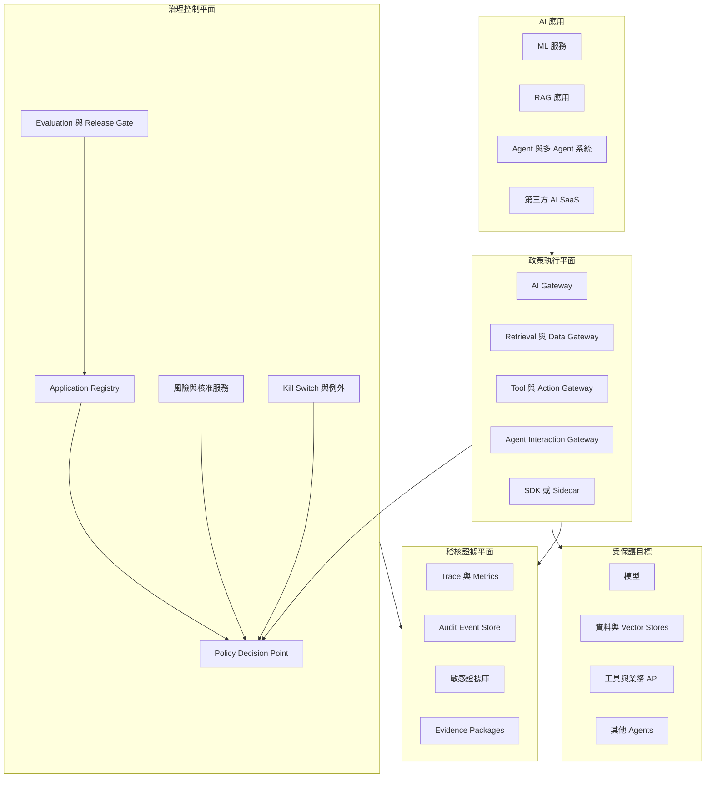
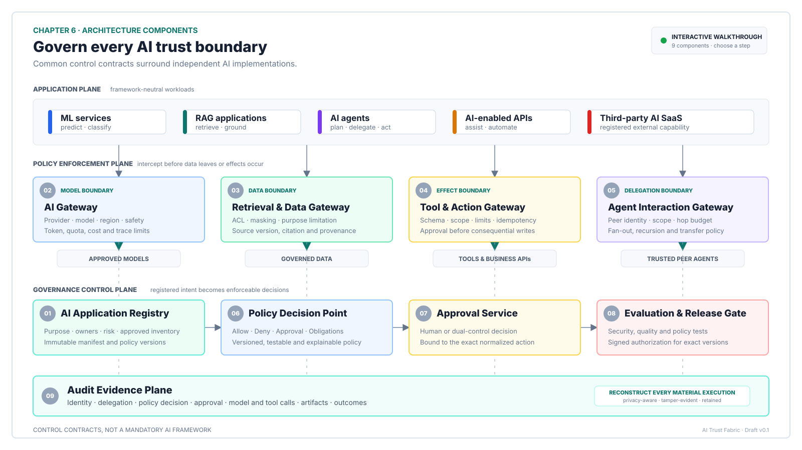
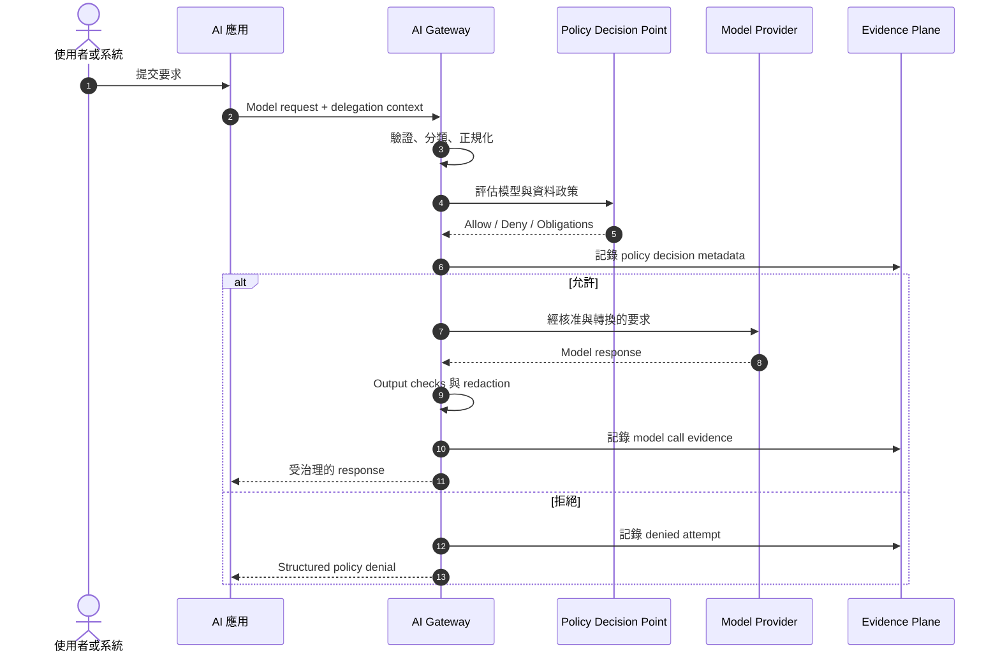
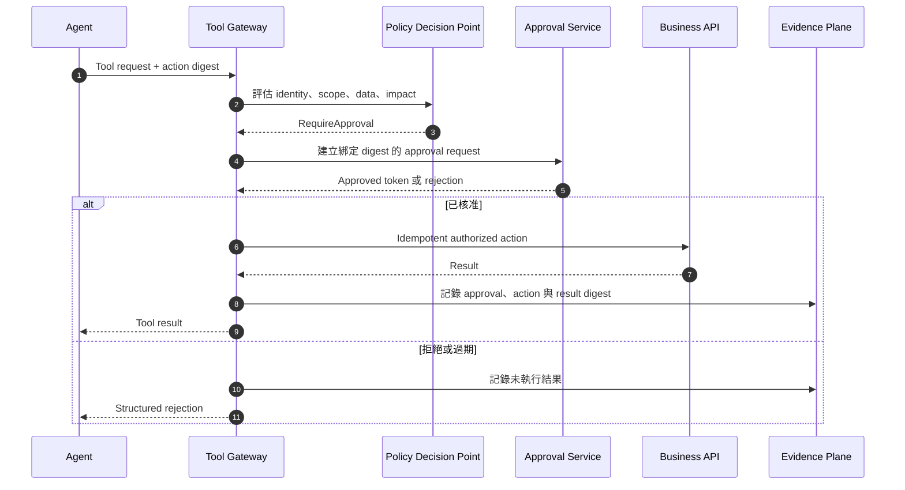
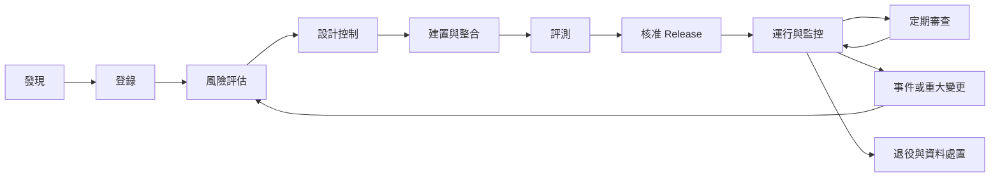
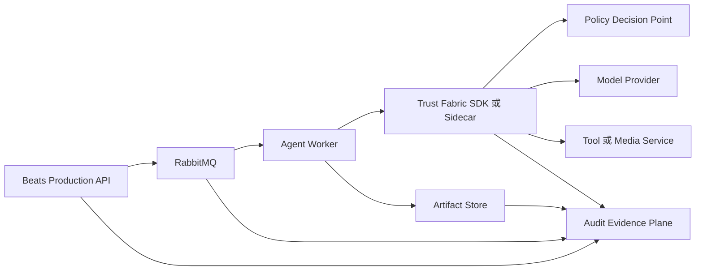

# AI Trust Fabric 架構規格

語言：[English](README.md) | [繁體中文](README.zh-TW.md)

> 狀態：Draft v0.1
>
> 最後更新：2026-10-28
>
> 適用讀者：AI 平台工程師、應用團隊、資安團隊、風險負責人、稽核人員、SRE 與法遵團隊

AI Trust Fabric 是一套技術中立的 AI 治理執行環境。它提供共通的身分、政策、資料、工具、核准、評測與稽核合約，但不要求所有應用程式採用相同的 AI framework。

應用程式可以使用 Microsoft Agent Framework、Semantic Kernel、LangGraph、OpenAI Agents SDK、自建服務、傳統機器學習、RAG、第三方 AI SaaS，甚至完全不使用 Agent framework。相容性來自共通的控制合約與 Policy Enforcement Point，而不是共用同一套應用程式 runtime。

本文件定義 Trust Fabric 的目標架構、必要合約、信任邊界、控制模型、執行流程與分階段建置計畫。

## 目錄

- [1. 目的](#1-目的)
- [2. 目標與非目標](#2-目標與非目標)
- [3. 設計原則](#3-設計原則)
- [4. 系統脈絡](#4-系統脈絡)
- [5. 信任與身分模型](#5-信任與身分模型)
- [6. 架構元件](#6-架構元件)
- [7. 接入等級](#7-接入等級)
- [8. 核心合約](#8-核心合約)
- [9. 政策模型](#9-政策模型)
- [10. 執行流程](#10-執行流程)
- [11. 風險分級](#11-風險分級)
- [12. 資料治理與隱私](#12-資料治理與隱私)
- [13. 安全需求](#13-安全需求)
- [14. 稽核與證據](#14-稽核與證據)
- [15. 可觀測性與維運](#15-可觀測性與維運)
- [16. 可靠性與故障語意](#16-可靠性與故障語意)
- [17. 治理生命週期](#17-治理生命週期)
- [18. 控制對照](#18-控制對照)
- [19. 參考部署架構](#19-參考部署架構)
- [20. Beats 參考整合](#20-beats-參考整合)
- [21. MVP 路線](#21-mvp-路線)
- [22. Repository 結構](#22-repository-結構)
- [23. 待決議事項](#23-待決議事項)
- [24. 詞彙表](#24-詞彙表)
- [25. 參考資料](#25-參考資料)

## 1. 目的

對於每一次具重要性的 AI 執行，Trust Fabric 必須讓組織能回答以下問題：

> 是誰，透過哪一個應用程式或 Agent，基於什麼委派權限與哪一版政策，將哪一類資料交給哪個模型或工具，得到什麼結果，經過誰核准，最後對哪個系統造成什麼影響？

平台控制以下五件事：

1. **身分**：是誰或哪個 workload 發出要求。
2. **範圍**：允許使用哪些模型、資料來源、工具與目的地。
3. **委派**：Agent 或 workload 代表誰執行操作。
4. **決策**：哪一版政策允許、拒絕、限制或暫停操作。
5. **證據**：日後如何重建決策與執行結果。

Trust Fabric 不是把所有 AI 系統裝進同一個容器，而是一組可互通的控制平面服務、執行攔截點、runtime contracts 與證據管線。

## 2. 目標與非目標

### 2.1 目標

- 支援傳統 ML、生成式 AI、RAG、Agent、多 Agent、MCP tools、API 與第三方 AI SaaS。
- 在本機、雲端、SaaS 與 hybrid 環境套用一致的控制。
- 在模型、檢索、工具與 Agent 呼叫鏈中保留終端使用者身分與委派權限。
- 對模型、資料、工具、目的地與 peer agents 落實最小權限與明確 allowlist。
- 提供可版本化、測試、審查與解釋的 Policy as Code 決策。
- 產出結構化、兼顧隱私且可偵測竄改的稽核證據。
- 依 use case 風險調整控制深度。
- 允許既有系統漸進式導入控制。
- 在穩定的治理合約後方保留 AI framework 的可替換性。
- 支援緊急停用、有限度降級與復原。

### 2.2 非目標

- Trust Fabric 不是 AI 模型供應商。
- 它不是所有 Agent 都必須採用的開發 framework。
- 它不保證模型輸出一定正確。
- 它不取代應用層授權與業務驗證。
- 應用程式接入 Trust Fabric 並不代表自動合規。
- 它不要求集中保存所有 Prompt 與 Response。
- MCP、A2A、API Gateway 或模型內容過濾器，任何一項單獨存在都不等於完整治理。
- 它不取代法務、隱私、資安、模型風險或業務負責人的專業判斷。

## 3. 設計原則

### 3.1 共用合約，獨立實作

應用程式共用 Manifest、身分、Policy Decision、Audit Event 與 Evidence 格式，但可以自由選擇語言、模型供應商、framework、部署環境與內部架構。

### 3.2 以使用情境為治理單位

登錄與風險接受應套用在具體 AI use case，而不是只看模型名稱。同一模型用於公開文字摘要可能是低風險，但若能修改客戶資料或金融紀錄，就可能是高風險。

### 3.3 對 Agent 採 Zero Trust

Agent 是一種非人員 workload identity。每次要求都必須經過驗證、授權、範圍限制與持續觀測。Agent 不得因開發者、服務帳號或終端使用者具有較高權限，就自動繼承全部權限。

### 3.4 保留完整委派關係

每一個下游要求都必須保留：

- 啟動任務的人員或系統主體；
- 目前實際執行操作的 workload identity。

有效權限是使用者權限、應用程式授權、Agent capability、平台政策與目標系統授權的交集。

### 3.5 在副作用附近執行政策

政策必須在實際可能產生影響的位置執行。Model Gateway 無法完整保護在模型呼叫以外發生的資料檢索、工具操作、Agent 訊息、檔案寫入、付款或資料庫修改。

### 3.6 Evidence by Design

每個具重要性的操作都應在執行時產生證據。稽核重建不能只依賴一般 application log 或操作人員的記憶。

### 3.7 敏感 telemetry 最小化

優先保存 metadata、識別碼、hash、資料分類、政策決策與 reference，而不是原始 Prompt、Response、文件、憑證或完整 tool arguments。敏感內容只能在有明確目的時選擇性收集，且必須加密、限制存取並設定保存期限。

### 3.8 依風險比例配置控制

低風險 use case 不應被迫使用與自主付款、影響客戶權益或安全系統相同的最重流程。

### 3.9 安全失敗

高影響操作在身分、政策、核准或證據服務無法使用時必須 fail closed。低風險唯讀操作只能使用事先核准且範圍受限的 fallback policy。

### 3.10 人員仍需負責

自動化可以協助決策與執行有限度操作，但 ownership、核准、例外接受與 incident response 仍必須指派給具名人員或組織角色。

## 4. 系統脈絡



### 4.1 平面分離

| 平面 | 責任 | 不應變成 |
|---|---|---|
| Application Plane | 業務邏輯與 AI capability | 隱藏的政策權威 |
| Enforcement Plane | 攔截、正規化、授權、限制與記錄操作 | 唯一的業務語意來源 |
| Control Plane | Registry、風險、政策、核准、release 與例外 | 每一個非重要操作的同步依賴 |
| Evidence Plane | Trace、audit、受保護證據、報表與 retention | 不受限制的 Prompt warehouse |

## 5. 信任與身分模型

### 5.1 Principal 類型

| Principal | 範例 | 必要識別碼 |
|---|---|---|
| 人員 | 員工、客戶、審核者 | `subject_id` |
| 呼叫端應用程式 | 貸款入口網站、內容服務 | `application_id` |
| Workload | API、worker、排程工作 | `workload_id` |
| Agent | 說書人、貸款 Agent、審查者 | `agent_id` |
| Model deployment | Hosted LLM 或 local model | `model_deployment_id` |
| Tool | Payment API、SQL tool、MCP server | `tool_id` |
| Data source | 文件索引、資料庫、object store | `data_source_id` |
| Peer agent | 內部或外部 A2A endpoint | `peer_agent_id` |

### 5.2 Delegation Context

每個受治理的要求都必須攜帶經簽章或具完整性保護的 delegation context：

```json
{
  "subjectId": "user-12345",
  "applicationId": "loan-document-agent",
  "workloadId": "loan-document-agent-prod",
  "agentId": "document-reviewer",
  "tenantId": "bank-a",
  "sessionId": "session-01J...",
  "traceId": "4bf92f3577b34da6a3ce929d0e0e4736",
  "delegatedScopes": [
    "documents:read:case-9281",
    "cases:update:case-9281"
  ],
  "issuedAt": "2026-10-28T03:10:00Z",
  "expiresAt": "2026-10-28T03:20:00Z"
}
```

需求：

- 平台支援時，憑證必須採短效期設計。
- 服務不得將終端使用者 bearer token 轉交給不受信任的模型或工具。
- 不同應用程式、環境與 privilege boundary 必須使用不同 workload identity。
- 原始 subject 與目前 actor 必須可以區分。
- 委派不得放大 subject 原有權限。
- Peer Agent 的身分文件與 endpoint 必須依 allowlist 或可信任 registry 驗證。

## 6. 架構元件



互動式導覽將第六章拆成九個手動步驟：先登錄 AI 使用情境，再攔截每個信任邊界，執行政策決策、綁定人工核准與 release evidence，最後保存完整 audit trail。可以使用上一步、下一步、步驟編號或直接點選圖中的元件切換。

### 6.1 AI Application Registry

Registry 是受治理 AI use case 的 system of record，保存：

- 負責單位與具問責性的風險角色；
- 業務目的與預期使用者；
- 環境與部署清冊；
- 風險分級與審查狀態；
- 核准的模型、區域、資料來源、工具、Agent 與目的地；
- 資料分類、保存、所在地與傳輸規則；
- 必要評測與 release threshold；
- 核准、例外與到期紀錄；
- 啟用中的 policy bundle 與 manifest version；
- Kill switch 狀態與維運聯絡人。

Registry 必須保留版本歷史。Production execution 必須引用 immutable manifest version，而不是只引用會變動的 latest record。

### 6.2 AI Gateway

AI Gateway 治理模型推論要求，負責：

- 驗證 caller 與 workload identity；
- 驗證 application 與 deployment registration；
- 執行模型、provider、region 與 capability allowlist；
- 套用 input 與 output policy checks；
- 執行資料傳輸、所在地、quota、rate、token 與 cost 限制；
- 正規化 provider metadata 與 finish reason；
- 傳遞 trace 與 policy decision identifiers；
- 產生 model-call audit events；
- 在送往 provider 前移除 secret 與禁止傳輸的資料；
- 提供經核准的 provider routing 與 fallback。

Gateway 不足以單獨保護模型要求以外的 retrieval 或 action。

### 6.3 Retrieval and Data Gateway

Retrieval Gateway 治理 AI 系統使用的 structured 與 unstructured data，負責：

- 執行 document、row、field、tenant 與 purpose-level authorization；
- 可行時使用有效委派身分進行查詢；
- 執行資料分類與 purpose limitation；
- 過濾、遮罩、tokenize 或 redact 敏感欄位；
- 記錄來源、版本、存取決策與結果 reference；
- 執行 vector index lifecycle、刪除與 tenant isolation；
- 避免共用服務帳號繞過來源系統 ACL；
- 產生可供日後驗證的 citation 與 provenance reference。

### 6.4 Tool and Action Gateway

Tool Gateway 治理會影響外部狀態的操作，負責：

- 驗證 Agent 與 delegated subject；
- 執行 tool allowlist 與 per-operation scope；
- 以嚴格 schema 驗證 arguments；
- 限制金額、筆數、目的地、時間與環境；
- 將 action 分類為 read-only、reversible、consequential 或 prohibited；
- 依政策要求 human approval 或 dual control；
- 發出 idempotency key 並支援 compensation reference；
- 防止 SSRF、unsafe URL fetch、shell injection、SQL injection 與 path traversal；
- 記錄正規化 action evidence 與 outcome hash；
- 實作 per-tool 與 global kill switch。

目標工具仍必須自行執行授權。Gateway 是附加的政策層，不取代 target system security。

### 6.5 Agent Interaction Gateway

Agent Interaction Gateway 治理 Agent 之間的訊息與委派工作，負責：

- 驗證 peer identity、endpoint、capability declaration 與 trust tier；
- 限制哪些應用程式可與哪些 Agent 溝通；
- 傳遞 delegation 與 trace context；
- 限制 task scope、data classification、time budget 與 tool budget；
- 防止循環委派與過度 recursion；
- 限制 fan-out、hop count、token spend、duration 與 retries；
- 記錄 task acceptance、refusal、completion 與 evidence reference；
- 對跨組織或跨區域傳輸執行資料政策。

### 6.6 Policy Decision Point

PDP 接收正規化 policy input，並回傳四種 outcome：

- `Allow`
- `Deny`
- `RequireApproval`
- `AllowWithObligations`

PDP 必須支援：

- versioned policy bundles；
- deterministic decision identifiers；
- policy tests 與 staged rollout；
- tenant 與 environment isolation；
- 適合 operator 與 auditor 使用的 decision explanation；
- 具 owner、期限與 compensating controls 的 time-bounded exception；
- global、application、model、agent、tool 與 data-source emergency block。

PDP 可以使用 OPA/Rego、Cedar 或其他 policy engine。Policy language 不得改變對外 decision contract。

### 6.7 Approval Service

Approval Service 管理 human-in-the-loop 與 dual-control decision，必須記錄：

- approval request 與 expiration；
- requested action 與 risk summary；
- requester、approver 與 segregation-of-duties checks；
- 提供給 approver 的 evidence；
- 核准範圍與修改內容；
- decision、time、reason 與 policy version；
- one-time authorization token 或 action binding；
- 最終執行結果。

Approval 必須綁定精確的 normalized action 或其 cryptographic digest。同一核准不得重放於內容不同的操作。

### 6.8 Evaluation and Release Gate

Release Gate 將一般 software assurance 與 AI-specific evaluation 結合。評測類型可包含：

- 任務正確性與 groundedness；
- hallucination 與 unsupported claims；
- prompt injection 與 indirect prompt injection；
- 敏感資料洩漏；
- 授權繞過與 cross-tenant leakage；
- 不安全的 tool selection 或 arguments；
- excessive agency、loop、fan-out 與 budget exhaustion；
- harmful、unfair 或 disallowed output；
- fallback 與 human escalation；
- latency、reliability 與 cost；
- rollback、kill switch 與 incident response 演練。

Release authorization 是一份對 application version、manifest version、policy bundle、model deployment、prompt assets、tool schemas、data-source versions 與 evaluation result set 的簽章聲明。

### 6.9 Audit Evidence Plane

Evidence Plane 接收所有 PEP 與 Control Plane service 的結構化事件，並分離 operational telemetry、audit records 與 sensitive evidence。

詳見 [14. 稽核與證據](#14-稽核與證據)。

## 7. 接入等級

不是每個應用程式都能提供相同的 runtime detail，因此平台支援四個等級。

| 等級 | 整合方式 | 典型系統 | 可提供的治理能力 |
|---|---|---|---|
| L0 | Registry only | Legacy system、opaque SaaS | 清冊、ownership、risk acceptance、人工 evidence |
| L1 | AI Gateway | 呼叫 model API 的應用 | Model allowlist、transfer rule、cost、基本安全與 audit |
| L2 | SDK 或 sidecar | 可修改的應用與 RAG | Session、prompt asset、retrieval、policy context、完整 trace |
| L3 | Agent runtime controls | Agent、MCP、A2A、自主 workflow | Tool authorization、delegation、approval、agent interaction、action evidence |

規則：

- 每個 production AI use case 至少必須完成 L0 登錄。
- Risk tier 決定最低允許接入等級。
- 高影響 write action 必須使用 L3 controls。
- 除非必要 evidence 可被觀測，且 enforcement 無法透過其他路徑繞過，否則不得宣稱已達 L2 或 L3。

## 8. 核心合約

### 8.1 AI Application Manifest

每個受治理 use case 都有一份 versioned manifest。以下 YAML 為示意，正式格式應由 JSON Schema 或等效 schema language 驗證。

```yaml
apiVersion: trustfabric.ai/v1alpha1
kind: AIApplication
metadata:
  id: loan-document-agent
  version: 1.4.0
  environment: production
  owner: corporate-banking-it
  riskOwner: corporate-banking-risk
  dataOwner: loan-operations

purpose:
  description: Summarize loan documents and propose case updates
  intendedUsers:
    - internal-employee
  prohibitedUses:
    - autonomous-credit-decision
    - customer-communication-without-approval

risk:
  tier: high
  dataSensitivity: confidential
  actionImpact: write
  autonomy: bounded-agent
  externalReach: internal-only

identity:
  workloadId: loan-document-agent-prod
  preserveUserDelegation: true
  maxDelegationHops: 2

models:
  allow:
    - provider: azure-openai
      deployment: approved-gpt
      region: japan-east
      capabilities:
        - text-generation
  denyPublicEndpoints: true

data:
  sources:
    - id: loan-document-store
      permission: read
      preserveSourceAcl: true
  allowedClassifications:
    - internal
    - confidential
  retention: P30D
  externalTransfer: false

tools:
  - id: document-search
    operations:
      - search
      - read
  - id: case-update
    operations:
      - propose
      - apply
    approval:
      apply: required
    idempotency: required

agents:
  peers:
    - id: document-classifier
      trustTier: internal
  maxFanOut: 3
  maxRuntime: PT10M

controls:
  promptContentLogging: disabled
  responseContentLogging: disabled
  piiDetection: required
  injectionDetection: required
  citations: required
  killSwitch: enabled
  policyBundle: finance-high-risk-v3

evaluation:
  suite: loan-document-agent-v5
  minimumScore: 0.90
  requiredSecurityTests:
    - prompt-injection
    - unauthorized-retrieval
    - unsafe-tool-use

evidence:
  auditRetention: P7Y
  sensitiveEvidenceRetention: P30D
  immutableAuditStore: required
```

### 8.2 Policy Decision Request

```json
{
  "decisionRequestId": "pdr-01J...",
  "occurredAt": "2026-10-28T03:10:02Z",
  "operation": "tool.execute",
  "application": {
    "id": "loan-document-agent",
    "version": "1.4.0",
    "manifestVersion": "sha256:..."
  },
  "principal": {
    "subjectId": "user-12345",
    "workloadId": "loan-document-agent-prod",
    "agentId": "document-reviewer",
    "delegatedScopes": ["cases:update:case-9281"]
  },
  "resource": {
    "type": "tool",
    "id": "case-update",
    "operation": "apply",
    "classification": "confidential"
  },
  "context": {
    "tenantId": "bank-a",
    "environment": "production",
    "riskTier": "high",
    "traceId": "4bf92f3577b34da6a3ce929d0e0e4736",
    "actionDigest": "sha256:..."
  }
}
```

### 8.3 Policy Decision Response

```json
{
  "decisionId": "pd-01J...",
  "outcome": "RequireApproval",
  "policyBundle": "finance-high-risk-v3",
  "policyVersion": "sha256:...",
  "matchedRules": ["FIN-TOOL-004", "HITL-002"],
  "reasonCodes": ["WRITE_ACTION", "CONFIDENTIAL_DATA"],
  "obligations": [
    {
      "type": "human-approval",
      "approverRole": "loan-operations-supervisor",
      "expiresInSeconds": 900,
      "bindTo": "sha256:..."
    },
    {
      "type": "redact",
      "fields": ["customerNationalId"]
    }
  ],
  "evaluatedAt": "2026-10-28T03:10:02Z"
}
```

### 8.4 Audit Event

```json
{
  "specVersion": "1.0",
  "eventId": "ae-01J...",
  "eventType": "ai.tool.execution.completed",
  "occurredAt": "2026-10-28T03:12:11Z",
  "recordedAt": "2026-10-28T03:12:12Z",
  "traceId": "4bf92f3577b34da6a3ce929d0e0e4736",
  "spanId": "00f067aa0ba902b7",
  "sessionId": "session-01J...",
  "applicationId": "loan-document-agent",
  "applicationVersion": "1.4.0",
  "manifestVersion": "sha256:...",
  "subjectId": "user-12345",
  "workloadId": "loan-document-agent-prod",
  "agentId": "document-reviewer",
  "operation": "case-update.apply",
  "resourceId": "case-9281",
  "dataClassifications": ["confidential"],
  "policyDecisionId": "pd-01J...",
  "policyVersion": "sha256:...",
  "approvalId": "approval-01J...",
  "requestDigest": "sha256:...",
  "resultDigest": "sha256:...",
  "outcome": "succeeded",
  "evidenceRefs": ["evidence://audit/2026/10/28/..."],
  "previousEventHash": "sha256:...",
  "eventHash": "sha256:..."
}
```

### 8.5 合約需求

- Identifier 必須 globally unique 或具 namespace。
- Timestamp 必須使用 UTC 與無歧義的標準格式。
- Schema 必須具版本，且在宣告的支援期間維持 backward compatibility。
- Producer 不得在 Audit Event 放入憑證或不受限制的原始內容。
- Decision 與 Audit Event 必須攜帶 policy version 與 manifest version。
- 重要 action 必須攜帶 request digest 與 result digest。
- Evidence reference 必須指向 access-controlled location，不得暗示內容可公開存取。

## 9. 政策模型

### 9.1 Policy Domains

| Domain | 決策範例 |
|---|---|
| Identity | 此 workload 是否可代表這個 subject 執行？ |
| Model | 此 model、capability、provider 與 region 是否核准？ |
| Data | 此資料分類是否可送往該目的地？ |
| Retrieval | 此 subject 是否可基於此目的讀取這些文件？ |
| Tool | 此 Agent 是否可用這些 arguments 執行此 operation？ |
| Agent | 此 Agent 是否可委派給該 peer？範圍為何？ |
| Budget | Token、cost、time、fan-out 與 retry budget 是否足夠？ |
| Approval | 是否需要 human approval 或 dual approval？ |
| Evidence | 必須保存哪些 metadata 或 protected content？ |
| Release | 此 application version 是否可部署到該 environment？ |

### 9.2 Policy Statement 範例

```text
DENY confidential data -> unapproved external model
DENY tool execution -> delegated scope does not include operation
DENY peer delegation -> hop count exceeds manifest limit
REQUIRE approval -> production write action
REQUIRE dual approval -> financial impact exceeds threshold
ALLOW WITH OBLIGATIONS -> redact fields and retain evidence digest
DENY execution -> application, agent, model, tool, or policy is suspended
```

### 9.3 評估順序

1. 驗證 contract 與 schema。
2. 驗證 subject、workload 與 agent 身分。
3. 載入 immutable manifest version。
4. 評估 global 與 emergency deny rules。
5. 評估 application 與 resource allowlist。
6. 評估 delegation、data、action 與 regional constraints。
7. 計算 approval 與 evidence obligations。
8. 回傳經簽章或具完整性保護的 decision。
9. 在不記錄禁止內容的情況下保存 decision。

Explicit deny 優先於 allow。除非 emergency policy 明確允許，否則 exception 不得覆蓋 global emergency block。

## 10. 執行流程

### 10.1 受治理的 Model Call



### 10.2 受治理的 Tool Action



### 10.3 受治理的 Retrieval

```text
Application request
  -> 保留 user 與 workload identity
  -> 授權 data source 與 purpose
  -> 套用 source-system ACL
  -> 過濾與遮罩 result fields
  -> 回傳 document ID、version、citation 與 content
  -> 記錄 authorization 與 provenance metadata
```

## 11. 風險分級

### 11.1 風險軸

風險分級至少使用三個軸。最終 tier 原則上採最高風險軸，只有經文件化審查後才能調整。

#### 資料敏感度

- 公開
- 內部
- 機密
- 個人或受規管資料
- 高度限制資料

#### 行動影響

- 讀取或分類
- 摘要或建議
- 產生草稿並由人員審查
- 寫入或對外溝通
- 金融、法律、安全、身分或資格決策

#### 自主程度與影響範圍

- 單次推論
- 固定 workflow
- Bounded agent
- 多 Agent 或動態選擇工具
- 跨系統自主執行

其他修正因子包含使用者族群、客戶曝險、可逆性、執行規模、模型不透明度、第三方依賴、跨區傳輸與對 protected groups 的影響能力。

### 11.2 控制等級

| Tier | 典型 use case | 最低控制 |
|---|---|---|
| Low | 公開內容摘要 | L1、owner、model allowlist、基本 audit、rate limit |
| Medium | 內部 RAG 或員工建議 | L2、source ACL、data classification、evaluation、monitoring |
| High | 客戶資料或 production write action | L3、workload identity、approval、tool controls、immutable audit、incident plan |
| Critical | 付款、授信、安全、法律狀態、身分 | L3、適用時 dual control、strict deny default、獨立驗證、加強 evidence 與 recovery |

Risk acceptance 必須具有 owner、rationale、expiration date 與 compensating controls。

## 12. 資料治理與隱私

### 12.1 必要控制

- 在 model、retrieval、tool 或 agent transfer 前完成資料分類。
- 記錄 purpose、適用時的 lawful basis、data owner、允許目的地與 retention。
- 在 inference 與 logging 前執行 data minimization。
- Retrieval 必須保留 source-system authorization。
- 分離 customer、tenant、environment 與 jurisdiction boundary。
- 對傳輸中與靜態資料加密。
- 將 credentials 與 secrets 排除於 Prompt、model context 與 audit payload。
- 適用時支援更正、刪除、legal hold 與 retention workflow。
- 記錄跨境或外部 provider transfer decision。
- 當合約與 Manifest 禁止時，防止 provider retention 或訓練使用。
- 測試 masked 或 transformed data 的 re-identification 與 leakage risk。

### 12.2 Content Logging 模式

| 模式 | 保存內容 | 用途 |
|---|---|---|
| Disabled | 只有 metadata 與 digest | 預設 production mode |
| Redacted | 經核准的 redacted fragment | Debugging 或 quality review |
| Protected | 加密完整 evidence，限制存取 | Incident、爭議或受規管調查 |

完整 Prompt 與 Response logging 不得作為預設值。啟用 protected content capture 必須具備 purpose、approval、access policy、retention 與 notification rules。

## 13. 安全需求

### 13.1 必要 baseline

- 驗證每個 human、workload、agent、tool 與 administrative operator。
- 採最小權限，並分離不同應用程式與環境的身分。
- 可行時使用 short-lived credential 或 managed identity。
- 將 secret 保存在核准的 secret manager 並定期 rotate。
- 執行 model、data source、tool、destination 與 peer-agent allowlist。
- 以嚴格 schema 與業務限制驗證所有 tool arguments。
- 將 model output、retrieved content、tool output 與 peer-agent message 視為不可信 input。
- 防禦 direct 與 indirect prompt injection。
- 隔離 code execution，限制 network、file、process 與 credential access。
- 限制 recursion、fan-out、runtime、token、cost、retry 與 concurrent action。
- Consequential action 必須使用 idempotency。
- Kill switch 不得依賴重新部署才能生效。
- 對 policy bundle、manifest、release 與 material evidence 進行簽章或完整性保護。
- 持續測試繞過 gateway 與 sidecar 的路徑。
- 依風險需要分離 administration、policy authoring、approval 與 audit access。

### 13.2 威脅類型

Threat model 至少必須涵蓋：

- identity spoofing 與 confused deputy；
- excessive agency 與 privilege escalation；
- prompt injection 與惡意 retrieved content；
- data exfiltration 與 cross-tenant leakage；
- unsafe tool arguments 與未授權副作用；
- 不可信或遭污染的 model、prompt、tool、data 與 agent card；
- memory poisoning 與 context manipulation；
- denial of wallet、resource exhaustion 與 infinite loop；
- audit suppression、evidence tampering 與 repudiation；
- approval replay 或 approval/action mismatch；
- supply-chain 與第三方 provider compromise；
- 透過 alternate endpoint 或 unmanaged local model 繞過控制。

## 14. 稽核與證據

### 14.1 Evidence Layers

| Layer | 目的 | 範例 |
|---|---|---|
| Operational telemetry | Reliability 與 performance | latency、error、token use、queue depth、health |
| Audit events | 重建 decision 與 action | identity、manifest、policy、model、tool、approval、outcome |
| Sensitive evidence | 受限制調查 | encrypted prompt、response、document fragment、tool payload |

### 14.2 最低 Audit Coverage

Audit event 必須涵蓋：

- application registration、approval、change、suspension 與 retirement；
- authentication 與 delegation establishment；
- policy allow、deny、approval、exception 與 obligation decision；
- model request 與 response metadata；
- retrieval authorization 與 provenance；
- tool request、approval、execution、compensation 與 failure；
- peer-agent task delegation 與 completion；
- evaluation、release、rollback 與 policy deployment；
- kill-switch activation 與 restoration；
- sensitive-evidence access、export 與 deletion。

### 14.3 完整性與存取

- 必要 retention period 內，Audit storage 應支援 immutability 或等效 tamper resistance。
- 需要 evidentiary integrity 時，Event 應包含 hash 或 signature。
- Audit 與 sensitive evidence access 必須和 application operator access 分離。
- 每次讀取或匯出 sensitive evidence 都必須再次留下 audit record。
- 必須同步時鐘並使用 UTC timestamp。
- Evidence 必須能依 application、subject、workload、agent、session、trace、policy decision、approval、model、tool 與 resource 查詢。
- Retention 必須由 policy 控制並支援 legal hold。

## 15. 可觀測性與維運

### 15.1 Trace Model

使用 distributed tracing 串起：

```text
user request
  -> application operation
  -> agent 或 workflow invocation
  -> policy decisions
  -> retrieval calls
  -> model calls
  -> tool calls
  -> peer-agent tasks
  -> final business effect
```

可行時使用 OpenTelemetry 產生 traces、metrics 與 logs。可依目前穩定程度採用 GenAI semantic conventions。Sensitive attributes 仍是 opt-in，並受 Trust Fabric evidence policy 控制。

### 15.2 必要 Operational Signals

- request count、success、denial、approval 與 failure rate；
- latency 與 time to first response chunk；
- 可取得時的 model input、output、cached 與 reasoning token usage；
- cost 與 budget consumption；
- retrieval result count 與 authorization failure；
- tool execution、compensation 與 idempotency conflict；
- agent recursion、fan-out、runtime 與 retry count；
- policy-decision latency 與 cache hit rate；
- queue depth、dead letter、evidence-ingestion lag 與 dropped telemetry；
- safety filter、DLP、injection 與 anomaly finding；
- kill switch 與 fallback activation。

### 15.3 SLO 範例

| Capability | SLO 範例 |
|---|---|
| Policy decision | High-risk synchronous decision 達 99.95% availability |
| Audit ingestion | 99.99% accepted；mandatory event 不得 silent loss |
| Kill switch | 在文件化 propagation objective 內生效 |
| Approval binding | Expiration 或 digest mismatch 後不得執行 |
| Evidence query | 在 investigation objective 內取得必要 audit record |

實際 target 必須依 risk tier 與 business criticality 決定。

## 16. 可靠性與故障語意

### 16.1 Delivery Guarantees

- Material operation 必須使用 stable idempotency key。
- Message-driven integration 應採 inbox deduplication 與 transactional outbox。
- At-least-once delivery 不得造成重複金融、客戶或外部副作用。
- Retry 必須 bounded、observable，並分類為 safe 或 unsafe。
- Dead-lettered work 必須保留 trace、policy 與 evidence reference。
- 可行時，long-running AI work 必須支援 checkpoint、timeout、cancellation 與 recovery。

### 16.2 Dependency Failure

| 故障 | High-impact 行為 | 可能的 low-risk 行為 |
|---|---|---|
| PDP unavailable | Deny 或 pause | 明確允許時使用 short-lived signed cached decision |
| Approval unavailable | Pause，不得自行核准 | 回傳 pending state |
| Audit store unavailable | Durable buffer 或在 effect 前 pause | Policy 允許且 local evidence durable 時才繼續 |
| Model unavailable | 核准的 fallback 或 fail | 回傳 degraded response |
| Retrieval unavailable | 不得虛構 grounded output | 回傳 partial 或 unavailable status |
| Tool unavailable | 僅在 idempotent 時 retry | 回傳 non-executed status |

Fallback 不得默默改變 provider、region、data handling、model capability 或 approval requirement。

## 17. 治理生命週期



### 17.1 需要重新評估的重大變更

- 業務目的或使用者族群改變；
- 新 model、provider、capability 或 region；
- 新 data classification 或 source；
- 新 tool、write permission、destination 或 peer agent；
- 提高 autonomy、fan-out、runtime 或 action impact；
- Prompt asset 的變更會實質影響行為；
- 新的法律、監理、契約或內部政策要求；
- 重大 incident、evaluation regression 或 observed misuse。

### 17.2 必要角色

| 角色 | 問責範圍 |
|---|---|
| Application owner | Purpose、operation、maintenance 與 remediation |
| Business owner | Intended outcome 與可接受業務行為 |
| Risk owner | Risk acceptance 與 control sufficiency |
| Data owner | Data purpose、access、quality、retention 與 transfer |
| Security owner | Threat model、security controls 與 incident response |
| Model 或 AI risk reviewer | Evaluation design、limitation 與 residual risk |
| Platform owner | Trust Fabric availability、integrity 與 control operation |
| Auditor | 獨立 evidence review |

## 18. 控制對照

Trust Fabric 提供可重複利用的技術證據，但不會自行產生任何法律、標準或主管機關的合規認證。適用性與解釋必須由合格的法務、法遵、資安、隱私與稽核人員審查。

| 來源 | Trust Fabric 對應方向 |
|---|---|
| ISO/IEC 42001:2023 | AI management system、責任、生命週期控制、performance evaluation、monitoring 與 continual improvement |
| NIST AI RMF | Govern、Map、Measure、Manage 生命週期成果 |
| OWASP GenAI 與 Agent Control guidance | Runtime hooks、Agent transparency、tool control、安全測試與威脅情境 |
| OpenTelemetry semantic conventions | Cross-service trace、metrics、logs、messaging 與 GenAI operation metadata |
| 台灣《人工智慧基本法》 | 人類自主、隱私與資料治理、資安、透明、公平與問責原則 |
| 台灣《個人資料保護法》 | Purpose、告知、同意或其他 legal basis、安全、權利、保存、傳輸與事故 evidence |
| 金管會《金融業運用人工智慧（AI）指引》 | 金融 AI 治理、資料保護、公平、透明、穩健與生命週期監控 |

Control catalog 應維護 many-to-many mapping：

```text
Trust Fabric Control
  -> 一個或多個 policy rules
  -> 一個或多個 technical enforcement points
  -> 一個或多個 evidence types
  -> 一個或多個法規或標準 references
  -> test procedure 與 control owner
```

## 19. 參考部署架構

### 19.1 技術中立 Baseline

| Capability | 實作選項 |
|---|---|
| Identity | Enterprise IdP、workload identity、short-lived token、mTLS |
| Gateway | API gateway、service mesh、reverse proxy、SDK、sidecar |
| Policy | OPA/Rego、Cedar、自建 policy service |
| Registry | Relational database 搭配 versioned object storage 或 Git review |
| Events | Kafka、RabbitMQ、cloud event bus、append-only event log |
| Audit | Security data lake、immutable object storage、SIEM |
| Trace | OpenTelemetry collector 與相容 backend |
| Approval | 整合 enterprise identity 的 workflow service |
| Secrets | Enterprise secret manager 或 HSM-backed key service |
| Evaluation | CI/CD test runner、red-team suites、production monitors |

### 19.2 Azure Reference Mapping

以下 mapping 僅為參考，並非強制：

| Trust Fabric capability | Azure 範例 |
|---|---|
| Human 與 workload identity | Microsoft Entra ID 與 managed identities |
| API 與 AI enforcement | Azure API Management 加 application PEP |
| Policy decision | Containerized OPA 或 organization policy service |
| Model services | Microsoft Foundry 與核准的 model endpoints |
| Data access | Application authorization 加 source-specific ACL enforcement |
| Secrets 與 keys | Azure Key Vault，必要時搭配 managed HSM |
| Audit stream | Event Hubs 或 Service Bus 與 durable consumers |
| Evidence storage | 必要時使用具 immutability 與 lifecycle policy 的 Azure Storage |
| Operational telemetry | Azure Monitor、Application Insights 與 OpenTelemetry |
| Security monitoring | Microsoft Sentinel 或其他 SIEM |
| Release automation | Azure DevOps 或 GitHub Actions 搭配 evaluation gates |

Production design 必須處理 tenant isolation、regional availability、data residency、private networking、key ownership、service limits 與 disaster recovery。

## 20. Beats 參考整合

Beats production pipeline 可以成為 Trust Fabric 第一個 L3 reference workload。

### 20.1 Beats 既有概念

| Beats 概念 | Trust Fabric 對應 |
|---|---|
| `ProductionId` | AI execution 或 governed session identifier |
| `EventEnvelope` | Domain audit 與 trace carrier |
| `CorrelationId` | End-to-end trace correlation |
| `CausationId` | Decision 與 event lineage |
| `AgentRole` | Agent 與 workload identity |
| `production-flow.json` | 經核准的 agent interaction 與 capability manifest |
| `ProductionSpec` | Purpose、requested outcome 與 execution constraints |
| `ArtifactReference` | Evidence 與 data-lineage reference |
| `AgentRunRecord` | Agent execution evidence |
| RabbitMQ event | Choreography event 與 PEP integration point |
| Artifact storage | 受治理的 content 與 evidence store |

### 20.2 Target Integration



第一批建議政策：

- 每個 Agent 只能 consume 設定允許的 event type；
- 每個 Agent 只能 publish 設定允許的 successor event type；
- 各 Agent 的 model provider、deployment 與 region 必須列入 allowlist；
- Artifact classification 決定允許的 provider 與 retention；
- Animator 與 Editor 的 external call 必須通過 destination policy check；
- 所有 external AI call 都要攜帶 production、trace、agent、manifest 與 policy identifiers；
- Artifact download 必須使用 scoped access，不使用 public container；
- 重複 event 必須在昂貴的 model 或 media generation 前完成 inbox deduplication；
- 最終 publish 採 outbox，保持 evidence、status 與 event delivery 一致；
- Emergency policy 可 suspend 單一 agent、provider、model、production 或完整 flow。

### 20.3 Reference Acceptance Test

當 auditor 能重建以下資訊時，Beats execution 才算受完整治理：

1. 使用者要求與核准的 Production Specification；
2. 每一個 event 與 causal predecessor；
3. 每個 Agent workload 的 identity 與 version；
4. 每個 model、provider、region、prompt asset、retrieval 與 tool；
5. 每個重要邊界套用的 policy decision 與 obligations；
6. 每個 input 與 output artifact 的 classification 與 digest；
7. Approvals、exceptions、retries、failures 與 compensating actions；
8. Final result 與 reviewer decision；
9. 可在不暴露給一般 operator 的情況下存取 sensitive evidence。

## 21. MVP 路線

### Phase 1：Registry 與 Evidence Foundation

交付：

- AI Application Registry 與 versioned manifest；
- risk classification 與 accountable owners；
- workload identities；
- AI Gateway model allowlist 與 regional routing；
- OpenTelemetry trace propagation；
- structured audit event schema 與 durable store；
- application、model 與 agent kill switch。

完成條件：

- 所有 pilot application 都有 approved manifest；
- 每個 model call 都可歸屬至 user、application 與 workload；
- audit evidence 包含 manifest 與 policy version；
- 完成 denied model 與 transfer scenario 測試；
- 完成 kill switch 演練。

### Phase 2：Data、Tools 與 Approval

交付：

- Retrieval Gateway 與 source ACL propagation；
- 具 strict schema 與 idempotency 的 Tool Gateway；
- human approval 與 dual-control；
- Policy as Code repository、tests 與 deployment pipeline；
- prompt injection、leakage 與 authorization evaluation suites；
- 具 retention 與 access audit 的 sensitive evidence vault。

完成條件：

- 未授權文件存取會被拒絕並留下 evidence；
- consequential write 無法繞過 approval policy；
- approval 綁定精確 action digest；
- repeated message 不會重複 consequential effect；
- evidence access 具有獨立授權與 audit。

### Phase 3：Agent Ecosystem 與 Continuous Assurance

交付：

- MCP 與 peer-agent governance profiles；
- delegation hop、fan-out、time、token 與 cost budgets；
- continuous production evaluation 與 drift monitoring；
- 自動產生 control-evidence package；
- model、prompt、tool、data、policy 與 agent supply-chain tracking；
- cross-application incident response 與 automated containment。

完成條件：

- multi-agent delegation 保持在 declared scope；
- dynamic tool 與 peer agent 無法繞過 registration；
- policy 與 evaluation regression 會阻擋 release；
- 可針對指定 execution 產生完整 evidence package；
- incident exercise 證明可執行 suspend、investigation、recovery 與 reapproval。

## 22. Repository 結構

未來獨立 Trust Fabric repository 可以採以下結構：

```text
/
  README.md
  README.zh-TW.md
  /docs
    /architecture
    /threat-models
    /control-mappings
    /operations
  /contracts
    /manifests
    /policy
    /audit-events
    /approvals
  /policies
    /global
    /risk-tiers
    /applications
    /tests
  /services
    /registry
    /policy-decision
    /approval
    /evidence
  /gateways
    /ai
    /retrieval
    /tools
    /agents
  /sdk
    /dotnet
    /python
    /typescript
  /evaluation
    /suites
    /datasets
    /release-gates
  /deploy
    /local
    /azure
  /samples
    /beats
```

## 23. 待決議事項

Production implementation 前，以下項目需要建立 Architecture Decision Record：

- canonical application-manifest schema 與 compatibility policy；
- policy engine 與 policy-authoring ownership model；
- centralized gateway、sidecar 與 SDK enforcement boundary；
- policy-decision signing、caching 與 outage behavior；
- audit event schema、immutability mechanism 與 retention classes；
- sensitive evidence collection 與 break-glass access；
- workload identity 與 delegation token format；
- approval workflow 與 segregation-of-duties model；
- Agent 與 MCP capability registration format；
- model、prompt、tool 與 dataset version-identification rules；
- multi-region architecture 與 data-residency boundaries；
- control ownership 與 independent assurance process；
- material change 與 reapproval threshold 定義；
- 可重複使用 open-source framework 的授權與發布模式。

## 24. 詞彙表

| 詞彙 | 定義 |
|---|---|
| AI Trust Fabric | 提供異質 AI 系統共通治理 runtime 與 control contract 的架構 |
| PEP | 攔截操作並執行 policy decision 的 Policy Enforcement Point |
| PDP | 評估 policy input 的 Policy Decision Point |
| Manifest | 宣告 AI 應用目的、資源、風險與控制的 versioned document |
| Workload identity | 指派給服務、worker 或 agent runtime 的非人員身分 |
| Delegation | Subject 傳遞給 workload 或 Agent 的有限度權限 |
| Obligation | 作為允許條件而必須額外執行的控制 |
| Evidence | 支援重建、assurance 或 investigation 的結構化紀錄 |
| Artifact | AI execution 所產生或消費的受治理內容 |
| Kill switch | 阻擋指定 application、agent、model、tool 或 operation 的 runtime control |
| MCP | 對 AI 應用提供 context 與 tool 的 protocol |
| A2A | Agent 之間的 interoperability pattern 或 protocol |
| RAG | Retrieval-augmented generation |

## 25. 參考資料

- [ISO/IEC 42001 說明](https://www.iso.org/insights/iso-42001-explained)
- [NIST AI Risk Management Framework 1.0](https://www.nist.gov/publications/artificial-intelligence-risk-management-framework-ai-rmf-10)
- [NIST Generative AI Profile](https://doi.org/10.6028/NIST.AI.600-1)
- [OWASP Agent Control Standard](https://genai.owasp.org/resource/agent-control-standard-acs/)
- [OWASP GenAI Security Project](https://genai.owasp.org/)
- [OpenTelemetry Semantic Conventions](https://opentelemetry.io/docs/specs/semconv/)
- [台灣《人工智慧基本法》](https://law.moj.gov.tw/LawClass/LawAll.aspx?pcode=H0160093)
- [台灣《個人資料保護法》](https://law.moj.gov.tw/LawClass/LawAll.aspx?PCode=I0050021)
- [金管會《金融業運用人工智慧（AI）指引》](https://www.fsc.gov.tw/websitedowndoc?file=chfsc/202408231741530.pdf&filedisplay=%E9%99%84%E4%BB%B6_%E9%87%91%E8%9E%8D%E6%A5%AD%E9%81%8B%E7%94%A8AI%E6%8C%87%E5%BC%95.pdf)

---

本規格是架構 baseline，必須依適用的組織、司法管轄區、產業、資料、使用者族群與 action impact 進行調整。本文件不是法律意見，也不構成任何認證或主管機關核准。
